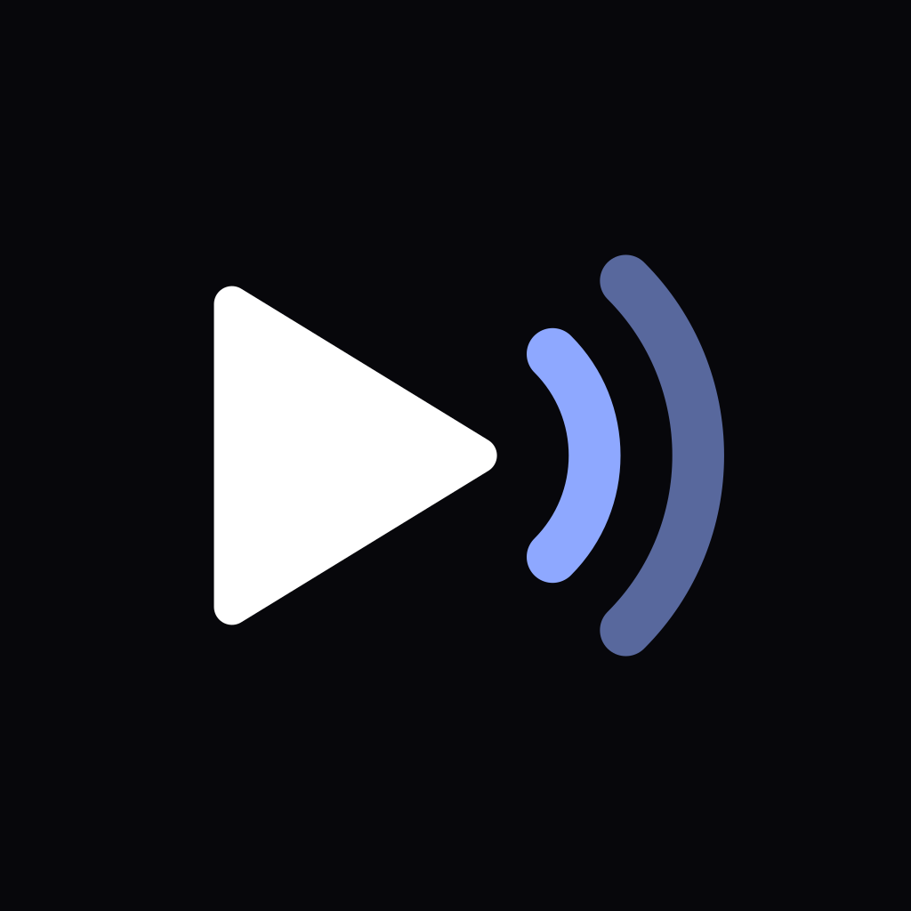
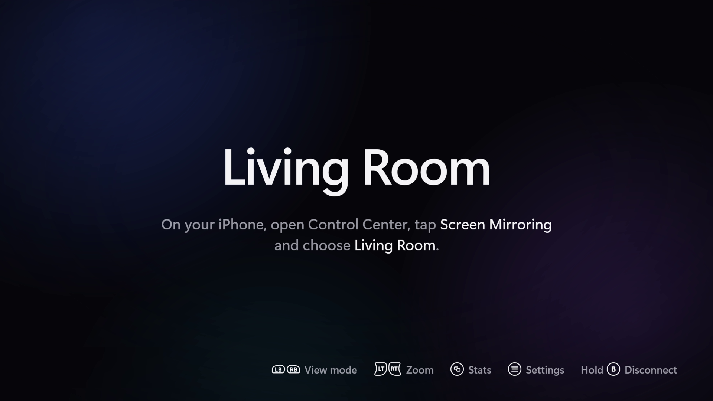
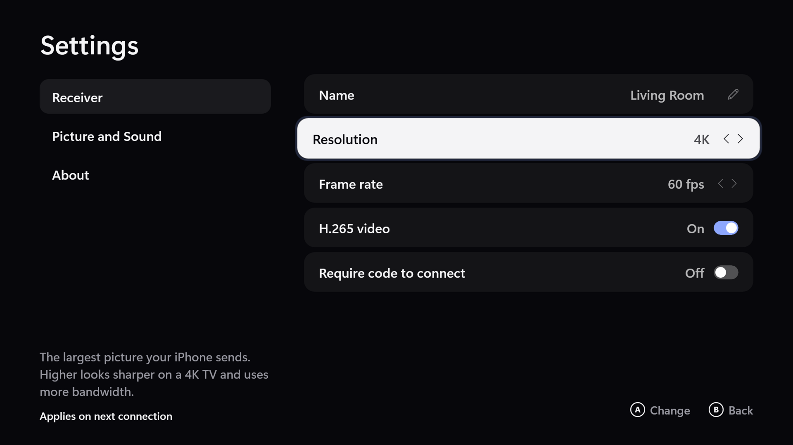
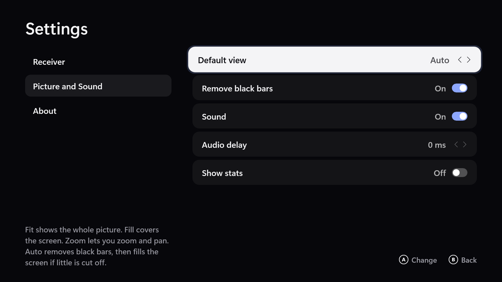

<p align="center">
  
</p>

<h1 align="center">Airtime</h1>

<p align="center">
  An AirPlay receiver for <b>Xbox</b>. Mirror your iPhone or iPad to the TV with sound and very low latency, or play
  music to the console from any app's AirPlay button. Free, open source, no time limits, nothing behind a paywall.
</p>

<p align="center">
  
  
  
</p>

> **Status:** works on the author's console (Xbox Series S, iPhone on iOS 27). It passed Microsoft Store
> certification, but the listing is **private**: it is not public on the Store yet. A public listing will happen if
> there's enough demand: star the repo or open an issue if you want it. Until then, build it yourself and sideload it in
> Dev Mode.

The repository keeps its original working name, `xbox-cast`. Airtime is an independent project. It is not affiliated
with, endorsed by or sponsored by Apple or Microsoft.

## Why

Every AirPlay receiver on the Xbox Store had about two stars when this started, and the best-known one is paid. Airtime
is built on the open [UxPlay](https://github.com/FDH2/UxPlay) protocol code, decodes video in hardware straight onto the
console's swap chain, and is driven entirely by the controller.

## Features

- **Screen mirroring** from iPhone and iPad: H.264 or H.265, up to 4K at 60 fps on a 4K console and TV. Hardware decode
  (D3D11VA) takes about 1-2 ms per frame and a frame reaches the screen 2-11 ms after it arrives, so latency is mostly
  your Wi-Fi.
- **Sound in sync**: AAC-ELD with an adaptive jitter buffer that rides out busy Wi-Fi, plus a manual audio delay for
  TVs that lag.
- **Fill the TV**: phones never send a TV-shaped picture, so there are four view modes. Fit, Fill (crop), Zoom (triggers
  to zoom, right stick to pan) and Auto, which finds the black bars an app adds and crops them away.
- **Audio-only AirPlay**: pick the console from an app's AirPlay button (Music, Spotify, a podcast app) and it plays as a
  speaker. The Now Playing screen (cover art, title, artist, album, progress) is new and not yet tested on a console.
- **Controller-first UI**: bumpers switch the view mode, X toggles sound, View shows live stats, hold B disconnects. A
  calm, TV-safe layout with controller-glyph hints on every screen.
- **Settings**: receiver name, 1080p / 1440p / 4K, 30 or 60 fps, H.265 on/off, and an optional on-screen code that a
  device must enter before it can connect.
- **Private by design**: works only on your local network. No account, no sign-in, no ads, no tracking. Nothing is
  recorded or sent anywhere.

### What it can't do

- **AirPlay video casting** ("play this video on the TV" from an app, without mirroring): not built. iOS falls back to
  audio only, which is why YouTube's AirPlay button plays sound but no picture. The official YouTube app on Xbox can
  take a cast from the phone instead.
- **AirPlay 2 multi-room audio**: needs PTP timing on ports 319/320, which Xbox apps can't bind; Airtime is a plain
  AirPlay speaker, not part of a multi-room group.
- **Protected video** (Netflix, Apple TV+ and the like): those apps block mirroring; the picture stays black.
- **Background playback**: Xbox suspends Airtime when a game starts. Keep it open while you mirror.
- **Mirroring from a Mac**: should work, not tested yet. Xbox One consoles are untested too.

## How it fits together

```
 iPhone / iPad
      │  AirPlay (mDNS discovery, RTSP, encrypted RTP video + audio)
      ▼
 castcore  (C, native/)  ── wraps the vendored UxPlay protocol library
      │  C API: video NAL units, audio packets, track info, cover art
      ▼
 Airtime app  (C++/WinRT UWP, app/)
   FFmpeg D3D11VA decode → D3D11 swap chain       XAudio2 output
   XAML UI: idle, connecting, mirroring overlay, now playing, settings
```

| Folder | What |
|---|---|
| `native/` | castcore: the receiver core (C) around the vendored UxPlay library, its unit tests, and `hostrx`, a Linux test receiver |
| `app/` | The Xbox app (C++/WinRT, XAML): media pipeline, renderer, audio, UI, diagnostics server |
| `docs/` | Architecture, the castcore C API contract, UI spec, design mockups, research notes, Store paperwork |
| `tools/` | Deploy CI builds to a Dev Mode console (`deploy.py`), read its logs (`devlog.py`), the repo scrub check |

## Install on Xbox (Dev Mode sideload)

1. Fork the repo and run **Actions → build** (it also runs on every push under `app/` or `native/`). It builds castcore,
   the app, and uploads the `xboxcast-x64` artifact: the `.msix` plus its dependency packages. No secrets are needed to
   try it; add a signing certificate to get in-place updates.
2. Put the console in Developer Mode, open Device Portal (`https://<xbox-ip>:11443`), and install the `.msix` together
   with the packages from `Dependencies/x64/`.
3. Launch **Airtime (dev)**. On your iPhone, open Control Center, tap Screen Mirroring and choose the name shown on the
   TV (default `Xbox`, change it in Settings).

Or from a dev machine with `gh` signed in: `tools/deploy.py --launch`. Step by step, signing and the Store build:
[docs/building.md](docs/building.md).

## Development

You don't need the console for most protocol work. castcore and `hostrx` build on Linux, and an iPhone can mirror to
`hostrx` directly:

```sh
sudo apt install libssl-dev libplist-dev libavahi-client-dev libavcodec-dev libavformat-dev libavutil-dev
cmake -S native -B build && cmake --build build -j && ctest --test-dir build
./build/hostrx --seconds 600          # shows up as an AirPlay receiver on your network
```

- [docs/architecture.md](docs/architecture.md): components and data flow.
- [docs/contract.md](docs/contract.md): the castcore C API, settings keys, the diagnostics server and file ownership.
- [docs/core.md](docs/core.md): castcore internals and the UxPlay changes. [docs/media.md](docs/media.md): decode,
  render and audio sync. [docs/ui.md](docs/ui.md): screens and controller mapping.
- [docs/research/](docs/research/): what is and isn't possible on a retail Xbox, and why.
- On the console, the app logs everything to a ring buffer served on port 7099 (Dev Mode builds):
  `tools/devlog.py status`, `tools/devlog.py log -f`.

Rules for contributors (and AI agents) are in [AGENTS.md](AGENTS.md): no personal data in the repo, run
`tools/scrub-check.sh` before committing, no formatter on existing files.

## Contributing

Issues and pull requests are welcome. For bigger changes, please open an issue first. Test UI changes at TV size with a
controller, and keep console test sessions short.

## License

[GPL-3.0](LICENSE), the same as UxPlay, whose AirPlay code is vendored here. You may use, study, change and share
Airtime; if you distribute a modified version, it must stay open source under the same license. Third-party code and
licenses: [THIRD_PARTY.md](THIRD_PARTY.md).

Xbox is a trademark of Microsoft Corporation. AirPlay, iPhone and iPad are trademarks of Apple Inc. These names are used
only to describe compatibility.
